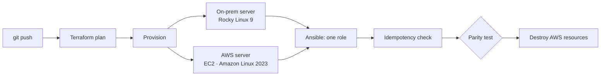

# Hybrid infrastructure with Terraform and Ansible

One `terraform apply` provisions a server on each side of a hybrid estate: **on-prem** (Rocky Linux 9) and **AWS** (Amazon Linux 2023 on EC2).
One Ansible role configures both. A parity test then proves the two are configured identically, even though they run different Linux distributions in different places.

[Live pipeline →](https://danielkojomegbenu.com/projects/hybrid-iac)

## The pipeline



| Step | What happens | Fails the run when |
|---|---|---|
| 1. Validate | `terraform fmt` and `validate` | The code isn't formatted or valid |
| 2. Plan | A one-time SSH key is made for this run, and the plan is saved | The plan fails |
| 3. Provision | Terraform builds the on-prem server and the AWS network and instance, then writes **one Ansible inventory** for both | AWS or Docker rejects a resource |
| 4. Configure | The `baseline` role: packages, UTC, a `deploy` user in `ops` with sudo, SSH hardening, a login banner, nginx | A task fails on either server |
| 5. Idempotency | The same playbook runs again and must change nothing | Anything changes on the second run |
| 6. Parity | Ansible reads 11 settings from each server and compares them | Any setting differs |
| 7. Destroy | Always runs, even after a failure, so nothing is left in AWS | |

## Why parity, not "it ran without errors"

Environments drift when someone fixes one server by hand. The parity test compares what each server actually ends up with:

```
MATCH  deploy user groups    on-prem: deploy,ops   aws: deploy,ops
MATCH  ssh password login    on-prem: no           aws: no
MATCH  timezone              on-prem: UTC          aws: UTC
MATCH  web page              on-prem: serves 200   aws: serves 200
...
11/11 settings match across on-prem and AWS
```

It compares settings, not package versions: the two distributions ship different nginx builds, but both must have nginx installed, running and enabled at boot.

## See drift fail the pipeline

Open the pull request **demo/snowflake-server**. It adds a "quick fix" that only applies to the on-prem server and turns password login back on.
Both servers configure without errors, but the **Parity test** fails on `ssh password login`, and the AWS resources are still destroyed.

## How each side is built

| | On-prem | AWS |
|---|---|---|
| Terraform module | `modules/onprem-server` (Docker provider) | `modules/aws-server` (AWS provider) |
| OS | Rocky Linux 9, systemd and SSH, like a data-centre VM | Amazon Linux 2023 on a `t4g.nano` |
| Network | The runner's own ports | Its own VPC. Only the runner's IP can reach SSH and HTTP |
| Access | A one-time SSH key per run | The same one-time key, as an EC2 key pair |

In CI the on-prem server is a systemd container on the runner. Point the module at a real hypervisor or bare-metal host, and the Ansible side doesn't change at all.

## Set it up in your own account

1. Create the IAM role GitHub Actions assumes with OIDC. It can only build a small network and a `t4g.nano`:
   ```bash
   cd bootstrap && terraform init && terraform apply
   ```
   Change `github_sub_prefix` and `state_bucket` first. The comments show how to find your values.
2. Change the state bucket in `terraform/main.tf`, then push.

## What's in the repo

| Path | What it is |
|---|---|
| `terraform/` | The root module, the two server modules, and the inventory Terraform writes |
| `ansible/` | `site.yml`, the `baseline` role and `parity.yml` |
| `scripts/parity.py` | Compares the two servers' settings |
| `bootstrap/` | The OIDC role, applied once by hand |
| `.github/workflows/hybrid.yml` | The pipeline |

## Cost

About $0.01 per run. The `t4g.nano` and its public IP exist for about 5 minutes, then the pipeline destroys everything. The on-prem side runs free on the GitHub runner.
